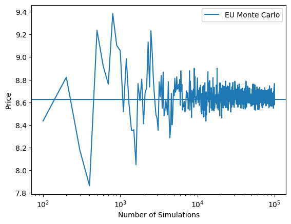
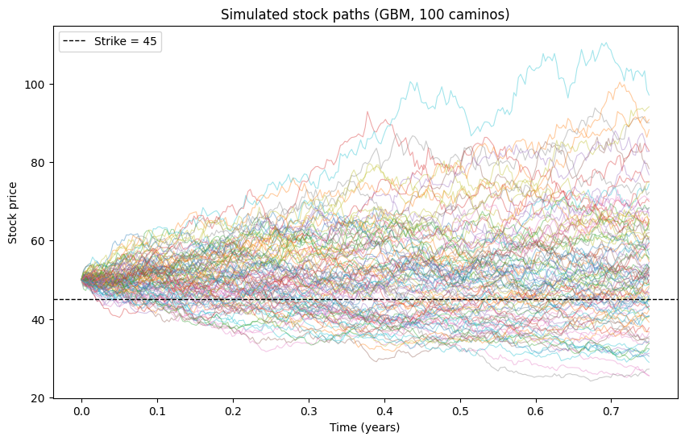

# Option Pricer

A Cox-Ross-Rubinstein binomial tree pricer for European and American
options, written in NumPy, with a continuous dividend yield. Includes
Greeks by finite difference, a Monte Carlo simulator with error bars,
and a Black-Scholes reference implementation for validation.

## Features

- European and American exercise
- Calls and puts
- Continuous dividend yield `q`
- CRR parameterization: `u = exp(σ√Δt)`, `d = 1/u`
- Greeks: delta, gamma, vega, theta
- Monte Carlo under geometric Brownian motion, with standard error and
  95% confidence interval
- Multi-step path simulation for plotting and for path-dependent payoffs
- Black-Scholes closed form for comparison
- No-arbitrage guard on the risk-neutral probability

## Setup

Requires Python 3.9+ and three packages:

```bash
pip install numpy scipy matplotlib
```

`numpy` for the tree and the simulation, `scipy` for the normal CDF in
Black-Scholes, and `matplotlib` for the charts.

## Usage

```python
option = Option_Pricer(s0=100, K=100, T=1, div=0, r=0.05, sigma=0.2,
                       n=500, opt="c", style="european")
option.opt_price(500)
option.Black_Scholes_Model()
option.delta()

monte_carlo(s0=100, K=100, T=1, div=0, r=0.05, sigma=0.2,
            N=1_000_000, opt="c", seed=42)
```

`monte_carlo` returns a pair: the price and its standard error.

## Method

### Binomial tree

Terminal stock prices are computed directly as `s0 * u^j * d^(n-j)`, then
converted to payoffs for the given strike and option type. Backward
induction then works from the last step (n) to step 0, which holds the
price today. Each node's value is the discounted, risk-neutral-weighted
average of its two children:

    e^(-rΔt) [ p·V_up + (1-p)·V_down ]

with

    p = (e^((r-q)Δt) - d) / (u - d)

The risk-neutral probability `p` is the weight that makes the stock's
expected growth equal the risk-free rate net of the dividend yield. It is
not a forecast: the option's value equals the cost of a portfolio of stock
and cash that reproduces its payoff, and `p` is the algebraic
rearrangement of that replication result.

The dividend yield enters `p` only. The discount factor stays `e^(-rΔt)`,
because what is being discounted is a cash amount, and cash does not pay
dividends.

For American exercise, each node takes the larger of the continuation
value and the intrinsic value.

### Monte Carlo

The terminal price is drawn directly from the closed-form solution of
geometric Brownian motion:

    S_T = s0 · exp[ (r - q - σ²/2)·T + σ√T·Z ],   Z ~ N(0,1)

This is exact, not a discretization, so a European price needs no
intermediate time steps. The price is the mean of the discounted payoffs,
and the standard error is their sample standard deviation divided by √N.

A separate function simulates full paths by drawing an `(N, steps)` matrix
of shocks and accumulating the log increments along the time axis. That
version is only needed for drawing the price fan and would be the starting
point for Asian or barrier payoffs.

## Validation

| Check | Result |
|---|---|
| Hand-built 3-step tree | 7.475, matches at every node |
| Hull worked example | 1.2823 call / 1.0592 put |
| Put-call parity, European | Holds to machine precision at all `n` |
| Put-call parity, American | Fails, as theory requires |
| Convergence to Black-Scholes | 10.446585 at `n=500` vs 10.450584 analytic |
| American call = European call, `q=0` | Identical to the last digit |
| American call > European call, `q=6%` | 7.254170 vs 7.071758 |
| American put > European put | Gap 0.519283 at `r=5%`, widening with `r` |
| Tree with `q=0` reproduces pre-dividend results | Exactly |
| Tree with `q=6%` vs Black-Scholes with `q=6%` | 7.071758 vs 7.075532 |
| Monte Carlo vs Black-Scholes, `N=10⁶` | 10.453195 ± 0.014731 contains 10.450584 |
| Monte Carlo confidence interval coverage | 95.4% over 500 runs at `N=20,000` |
| Delta vs analytic | 0.63677 vs 0.63683 |
| Vega vs analytic (per 1% of vol) | 0.375052 vs 0.375240 |
| Theta vs analytic | −0.017567 vs −0.017573 per day |

### Tree convergence


An option's payoff has a sharp corner at the strike price. When the
number of steps is even there is a node sitting exactly at K (here,
because K = s0); when it is odd, the strike falls between two nodes.
The price therefore alternates between being a notch too high and a
notch too low depending on the step count, rather than converging
smoothly.

With `q = 0` the American and European call lines coincide exactly and the
European line is hidden underneath. That is the result, not a plotting
fault: without dividends there is never a reason to exercise a call early.
Paying the strike later is worth something when `r > 0`, and holding the
option rather than the stock keeps the downside protection. With `q > 0`
the dividends forgone can outweigh both, the lines separate, and the gap
is the value of the early-exercise right.

### Monte Carlo convergence



The two convergence charts fail in different ways, which is the point of
having both. The tree oscillates in a regular, predictable pattern: its
error is systematic, so the same `n` always gives the same number, and
that number is displaced in a known direction. Monte Carlo trembles
irregularly: its error is random, so the same `N` with a different seed
gives a different number. In exchange, it can report how far off it
probably is, which the tree cannot do.

The error falls as `1/√N`. Cutting it by a factor of ten costs a hundred
times the work — 0.148 at `N=10,000`, 0.047 at `N=100,000`, 0.015 at
`N=1,000,000`. For a vanilla European the tree reaches the same accuracy
in milliseconds, so Monte Carlo earns its place only where the tree cannot
go: payoffs that depend on the path taken, or on several underlyings at
once.

### Simulated paths



100 paths under the same parameters, with the strike marked. The fan
widens as `√t` rather than linearly, which is the same `√T` that appears
in the terminal-price formula.

### Greeks


**Delta** is computed as the slope of the option value with respect to
the stock price. It follows the shape of a cumulative distribution
function: at low stock prices the put's delta approaches −1, so the
option moves almost one-for-one against the stock.

**Gamma** is the slope of the delta curve. It peaks as the stock
approaches the strike, which is where delta changes fastest.

**Vega** is the change in price per unit of volatility, reported per
percentage point. Near the strike, a change in volatility could leave the
option far in or far out of the money, so volatility matters more there
than anywhere else — hence the peak.

**Theta** measures the effect of time passing. Far out of the money the
value barely moves, since there is little value left to lose. Far in the
money with `r > 0`, theta is positive: exercise is near-certain, so the
put behaves like a claim on the strike at expiry, and as expiry
approaches that claim is discounted less. Setting `r = 0` removes the
discount and the positive region disappears, confirming the cause. The
most negative theta sits slightly out of the money, where uncertainty
about the outcome is greatest.

## Model limits

The tree requires `d < exp((r-q)Δt) < u`. With `q = 0` this reduces under
CRR to

    r·√Δt < σ

If violated, the risk-neutral probability falls outside [0, 1] and the
model returns meaningless prices without error. Example: `r=0.5`,
`σ=0.02`, `n=1` gives `p = 16.71` and a price of −18.87.

A guard raises `ValueError` when `p` leaves [0, 1].

Note this depends on `n`: the same `r` and `σ` can be invalid on a
coarse tree and valid on a fine one, since `√Δt` shrinks as steps are
added. A large dividend yield tightens the condition further, since it is
`r - q` and not `r` that has to sit between the two moves.

Volatility is constant throughout. The model inherits the usual
Black-Scholes blind spots: real return distributions have fatter tails
than the lognormal assumption allows, and implied volatility varies with
strike and maturity rather than sitting at one number.

## Known issue: gamma

Gamma by central difference on `s0` is unstable, because a binomial
tree's price is not smooth in `s0` — the lattice shifts rather than
sliding along a curve.

| h | Gamma |
|---|---|
| 0.01 | 3.354568 |
| 0.1 | 0.335457 |
| 0.5 | 0.067091 |
| 1 | 0.033546 |
| 2 | 0.020309 |
| Black-Scholes | 0.018762 |

The value does not converge as `h` shrinks; it diverges. The proper fix
is to read gamma off the tree's own nodes at step 2 rather than
repricing. Not implemented.

## Not implemented

- Implied volatility solver
- Tree-node Greeks
- American Monte Carlo (Longstaff-Schwartz regression on continuation values)
- Path-dependent payoffs: Asian, barrier
- Discrete dividends, as opposed to a continuous yield
- Variance reduction (antithetic variates, control variates)

## References

- Hull, J. *Options, Futures and Other Derivatives* — chapter on binomial trees.
- Cox, J., Ross, S. and Rubinstein, M. (1979). "Option Pricing: A Simplified Approach."
- Glasserman, P. *Monte Carlo Methods in Financial Engineering* — chapters 1 and 4.
- Lo, A. *Options, Part III*, 15.401 Finance Theory I, MIT OpenCourseWare.
  https://ocw.mit.edu/courses/15-401-finance-theory-i-fall-2008/
